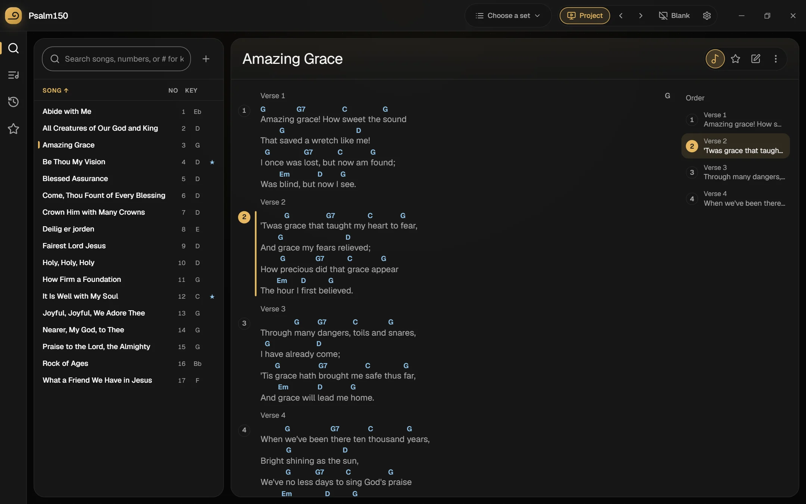
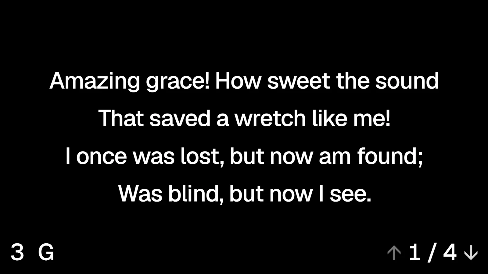
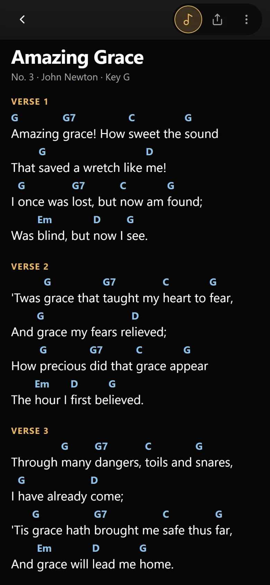
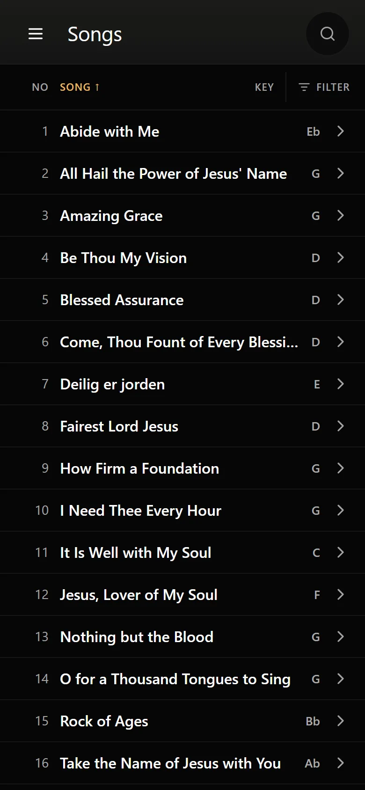

# Psalm150

> Let every thing that hath breath praise the LORD. Praise ye the LORD.
> — Psalm 150:6 (KJV)

**Song books for small churches.** Psalm150 puts the words on the screen for
the congregation, the chords in front of the musicians, and the church's song
book in everyone's pocket. It is free, it is small, and it runs on what a
small church already has: a laptop by the projector and, if you like, a
Raspberry Pi in a cupboard.

Psalm150 exists to help song leaders and church members write, prepare, sing
and share songs. Its tools are there to support worshippers in glorifying the
one Lord, Jesus Christ. Freely ye have received, freely give (Matthew 10:8):
the whole thing is free, and open under the MIT license.



## What's in it

### The desktop app — `desktop/`

The program on the computer by the projector. Search the song book, press
Project, and the words are on the screen.

- Words on the congregation's screen, chords on an optional stage screen for
  the musicians, the operator's console on the laptop.
- **No server, no internet needed.** A folder of ChordPro files is the song
  book (a Dropbox folder works fine). It runs a whole service offline.
- Brings over an old Visual Song Book `.mdb` song book.
- Sets for the service, a phone as a remote, and songs found online when you
  ask, with chords from the web laid over your own words.
- Windows, macOS and Linux. The Windows installer is about **7 MB** (10–11 MB
  on macOS and Linux): built with [Tauri](https://tauri.app), it uses the web
  view the system already has instead of shipping a browser.
- Updates itself in the background and installs when the program is closed,
  never in the middle of a service.



**Download:** [the latest release](https://github.com/nitech/psalm150/releases/latest).

### The song server — `api/` and `web/` (optional)

For a church that wants one shared song book for everyone. The desktop app
works without it.

- One Rust program and PostgreSQL, started with Docker Compose. No Redis, no
  message queue, no cloud account. It runs on a Raspberry Pi;
  [the dev server](https://dev-server.example) does.
- The church's songs with their full history, and sets for each service that
  a leader can share on a link.
- A web app for phones in 14 languages: the song book with chords, diagrams
  and sound, transposing, recordings of how a song is played.
- **Rooms:** anyone in the church can follow the projected words on their own
  phone, as large as they need, by typing the room's name at `/join`. No
  account, no app.
- Desktops connect to it and keep an offline copy, so a service never depends
  on the network.
- Everything goes through one documented API (`/api/docs` on any server).

<p>
  
  
</p>

More in [docs/song-server.md](docs/song-server.md).

### Shared code — `shared/`

What the two apps have in common, used by both as it is: the song editor and
reader, chords with diagrams and sound, design tokens and icons, and the
online song lookup (`shared/lyrics`, a Rust crate).

## Principles

- **Small.** Few dependencies, small downloads, a server that fits on a
  Raspberry Pi. Nothing a small church has to pay for or look after without
  a good reason.
- **Offline first.** The projector computer never waits for a server or the
  internet.
- **The church owns its songs.** ChordPro files in, ChordPro files out.
- **People lead.** Tools help; they never take over from the song leader.

## Run a song server

On any machine with Docker (the dev server runs on a Raspberry Pi):

```sh
git clone https://github.com/nitech/psalm150.git
cd psalm150
cp .env.example .env      # set a long, random POSTGRES_PASSWORD
docker compose up --build -d
```

Open `http://<the machine>:8080` for first-run setup. To reach it from
outside the church building, put it behind a reverse proxy or a tunnel; see
[docs/song-server.md](docs/song-server.md).

## Develop

You need [Bun](https://bun.sh), Rust (`rustup`), and Docker or PostgreSQL for
the server. On Windows, the desktop also needs the
[Visual Studio Build Tools](https://visualstudio.microsoft.com/visual-cpp-build-tools/)
with the C++ workload.

| Part | Start | Test |
| --- | --- | --- |
| Desktop | `cd desktop && bun install && bun run tauri dev` | `bun run test`, `bun run test:rust` |
| Server API | `cargo run --manifest-path api/Cargo.toml` (needs `DATABASE_URL`) | `cargo test --manifest-path api/Cargo.toml --all-features` |
| Web client | `cd web && bun install && bun run dev` (proxies `/api` to port 8080) | `bun run test` |
| Lyrics crate | | `cargo test --manifest-path shared/lyrics/Cargo.toml` |

A change in `shared/` reaches both apps, so build and test both. Run
`git config core.hooksPath .githooks` once per clone; it bumps the server's
version on commits that change it.

Pushing to `main` publishes: a change to `desktop/` or `shared/` becomes a
desktop release that installed copies download
([how](desktop/README.md#releasing--auto-updates)), and a change to the
server is deployed to the dev server.

```text
desktop/   The desktop app (Tauri 2: Rust core in src-tauri/, Lit frontend in src/)
api/       The song server's API (Rust, Axum, PostgreSQL migrations)
web/       The song server's web client (TypeScript, Vite)
shared/    Code both apps use: song modules, sounds, tokens, icons, lyrics crate
site/      The public site (psalm150.app): one static page from the same tokens
docs/      Server architecture, API and delivery notes
```

Notes for AI agents are in [AGENTS.md](AGENTS.md) and
[desktop/AGENTS.md](desktop/AGENTS.md), with compiled knowledge in `.wiki/`
and `desktop/.wiki/`.

## License

[MIT](LICENSE). The piano and guitar recordings for playing chords are
CC BY 3.0, credited in [shared/sounds/CREDITS.txt](shared/sounds/CREDITS.txt).
Libraries keep their own licenses.

Psalm150 comes without songs. The songs you add belong to the people who
wrote them, so keep your church's song license (such as CCLI) in order.
